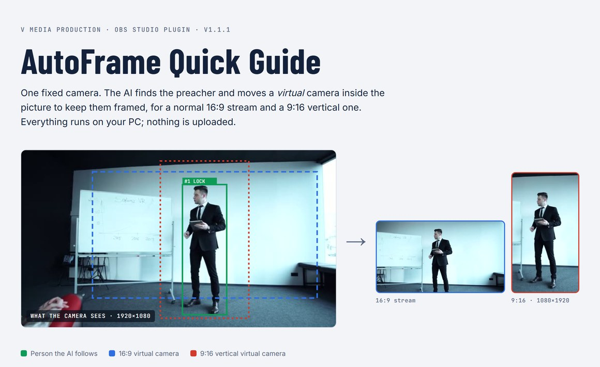
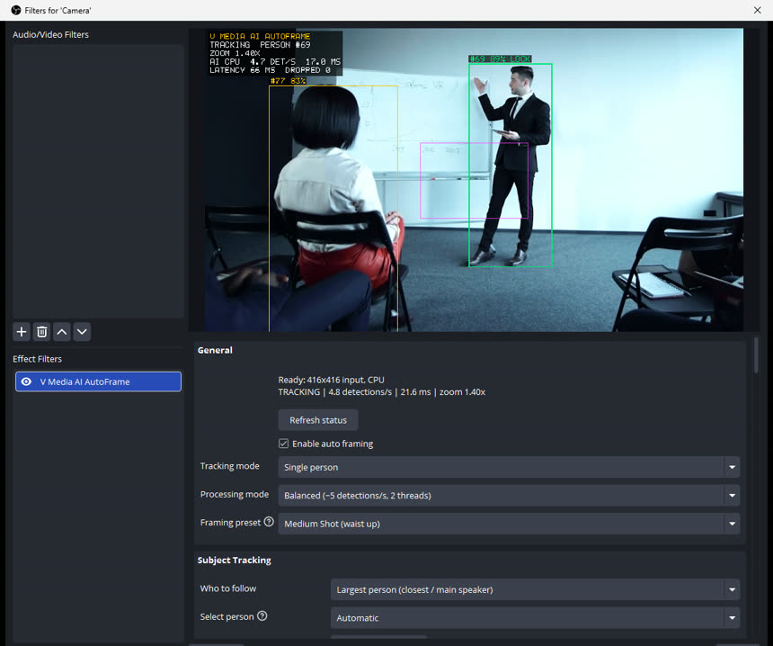
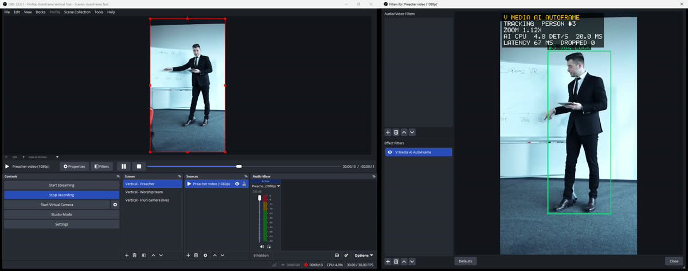
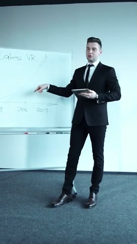
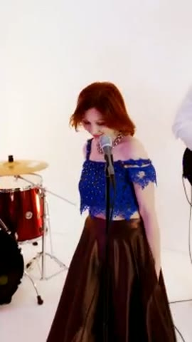

# V Media AI AutoFrame

**AI auto-framing for OBS Studio - by V Media Production.**

A native OBS Studio video filter that finds people in your camera feed with an on-device AI
model and keeps the right person framed with smooth digital pan, tilt and zoom. Built for
church live streams (a preacher walking the stage), worship teams, conferences, classrooms,
interviews and podcasts - with any HDMI camera and capture card, no PTZ camera needed.
Works for normal **16:9** streams and **vertical 9:16 (1080x1920)** streams for YouTube Shorts,
Instagram, Facebook and TikTok live.



* **Offline and private** - all processing on your PC; no cloud, no account, no subscription,
  no telemetry, no face recognition.
* **Runs on ordinary hardware** - CPU inference by default (~15 ms per detection, ~0.25 of a
  CPU core); optional GPU inference via DirectML on any DirectX 12 card, GTX 1650/1660
  included. No RTX, CUDA or TensorRT.
* **Never stalls the stream** - the AI runs on its own low-priority thread; OBS never waits for
  it. Measured: 0 lagged frames over 2,179 frames, 0 dropped frames in 1080p30 and 1080x1920
  x264 recordings with the AI running.
* **Tracking graphics never go on air** - boxes and stats appear only in preview windows; every
  frame of the stream / recording is clean (verified frame by frame).
* **OBS 30, 31, 32, 33** - Windows 10/11 64-bit and macOS 13.4+ (Apple silicon + Intel).

## Download

Get the latest installer from **[Releases](https://github.com/vinitdeep/obsautoframe/releases)**:

* **Windows:** `VMedia-AI-AutoFrame-Setup-x64.exe` (or the ZIP for manual / portable installs).
  Close OBS, run the installer, start OBS.
* **Mac:** `VMedia-AI-AutoFrame-<version>-macOS.dmg`. Open it, double-click
  *Install V Media AI AutoFrame.pkg*. Not notarized yet: if macOS blocks it, use
  System Settings > Privacy & Security > Open Anyway.

Details: [docs/INSTALLATION.md](docs/INSTALLATION.md).

## How to use - quick guide

**[Illustrated quick guide (image)](docs/guide/AutoFrame-Quick-Guide.png)** ·
**[Online version](https://claude.ai/artifact/2m8MaoVCJa5ja5ezUWBza8?sk=M1vmCIvAcKuuXBfZmzHTUw)** ·
[Full user guide](docs/USER-GUIDE.md)

1. **Install** the plugin (close OBS first, click *Yes* on the Windows admin prompt).
2. **Add the filter:** right-click your camera / capture-card source > **Filters** > **+** under
   *Effect Filters* > **V Media AI AutoFrame**. Wait a second for `Ready`.
3. **Pick a preset:** *Church Preacher*, *Worship Leader*, *Group* or *Medium Shot*.
4. **Show it the stage:** set *Subject Tracking > Stage area bottom edge* just below the stage
   floor (the congregation in front is then ignored) and press **Set pulpit to the preacher's
   current position** - the shot stays perfectly still while they preach at the pulpit.
5. **Landscape or vertical:** keep *Output aspect ratio: Same as camera* for 16:9. For vertical,
   set OBS *Settings > Video* to **1080x1920** and the filter to **9:16** with *Output resolution:
   Auto* - the camera fills the vertical canvas exactly.
6. **Go live.** Viewers never see the tracking boxes.

<p>


</p>

*Left: the filter's settings and live tracking view. Right: during a recording in OBS - the main
preview (what the stream / recording gets) is clean while the Filters window shows the boxes.*

### Vertical 1080x1920

<p>


</p>

* The 9:16 shot follows the person left and right inside the landscape camera picture.
* When a worship team is wider than the vertical frame, Group mode frames the **lead person plus
  everyone who fits completely** - nobody is cut in half.
* A **detail guard** caps the zoom when a 1080p camera cannot deliver the detail (a 4K camera
  keeps the full zoom range); optional detail sharpening restores edge contrast.
* Horizontal **and** vertical at the same time: keep the camera clean, put it in two scenes and
  add one AutoFrame filter to each scene (16:9 on one, 9:16 on the other).

### During the service

Assign hotkeys in OBS *Settings > Hotkeys* (listed under the filter's name) or a Stream Deck:
pause / resume tracking · force wide shot · lock current position · zoom in / out · reset zoom ·
follow next / previous person · switch single person / group · reset framing.

## Features

| | |
|---|---|
| Detection | YOLOX-Nano / YOLOX-Tiny (Apache-2.0) via ONNX Runtime, configurable confidence and rate (0.5-30/s) |
| Tracking | ByteTrack-style multi-person tracker, temporary IDs, person lock, re-acquisition after occlusion |
| Who to follow | largest / most central / most visible / operator choice, next & previous person, **stage area** to ignore the congregation |
| Framing | 10 presets incl. **Church Preacher**, Worship Leader, Interview, Group; headroom, offsets, safe margin |
| Church Preacher Mode | pulpit anchor (perfectly still at the pulpit), slow cinematic moves, dead zones, return to pulpit |
| Zoom | automatic, min/max limits (1.4x default), detail guard, speed, smoothing, dead band, manual zoom |
| Motion | critically-damped, frame-rate independent, speed + acceleration limits; crop never leaves the image |
| Group | frames the whole team; in narrow frames the lead plus whoever fits whole; ignores background people |
| Recovery | hold, timeout, glide to a safe wide shot, resume |
| Manual override | pause, force wide, lock, zoom in/out, reset zoom, reset, next/prev person, single/group - buttons + OBS hotkeys |
| Output | same as camera, 16:9, **9:16 vertical (1080x1920)**, 1:1, 4:5, 4:3; output resolution Auto / 720-2160; bicubic sub-pixel scaling + optional sharpening |
| Debug | boxes, IDs, live stats, dead zone / pulpit / stage guides - shown only in preview windows, never in the stream or recording |

## Tested

All automated, see [docs/TESTING.md](docs/TESTING.md) for details and what is *not* yet tested:

* 51 unit / scenario tests (tracking, framing, zoom, recovery, vertical groups, output sizes)
* real ONNX Runtime + YOLOX models on real footage, CPU and GPU benchmark
* inside the real OBS 33.0.1 engine: tracking, bit-exact fidelity at zoom 1.0, overlay safety,
  60 live settings changes, broken model / missing runtime (no crash), multiple instances,
  resolution change, GPU, 1080p30 and 1080x1920 x264 recordings with 0 dropped frames, 0 leaks
* real OBS GUI smoke test, and in an installed OBS: installer, recording, vertical canvas

Measured on Ryzen 5 3600 + GTX 1650: inference 15 ms (CPU, 2 threads) / 4.4 ms (DirectML GPU).

## Documentation

* [Quick guide (image)](docs/guide/AutoFrame-Quick-Guide.png) - one page, illustrated
* [User guide](docs/USER-GUIDE.md) - presets, Church Preacher Mode, stage area, group mode, vertical, hotkeys, performance
* [Installation](docs/INSTALLATION.md) - installer, ZIP, portable OBS, uninstall
* [Troubleshooting](docs/TROUBLESHOOTING.md)
* [Testing](docs/TESTING.md) - what was tested and measured, and what was not
* [Architecture](docs/ARCHITECTURE.md) - threads, pipeline, design trade-offs
* [Building from source](docs/BUILD.md)
* [Release notes](RELEASE_NOTES.md)

## Build

```powershell
scripts\setup.ps1                 # dependencies (OBS API headers + import libs, ONNX Runtime, DirectML, models)
tests\fetch-test-media.ps1        # test footage (not redistributed in this repo)
scripts\build.ps1 -Integration    # build + unit tests + real-model test + tests inside real libobs + OBS GUI test
scripts\package.ps1               # installer, ZIP, SHA256SUMS
```

## License

GPL-2.0-or-later (like OBS Studio itself) - see [LICENSE](LICENSE).
Third-party components and their licenses: [THIRD_PARTY_NOTICES.md](THIRD_PARTY_NOTICES.md).

(C) 2026 V Media Production.
